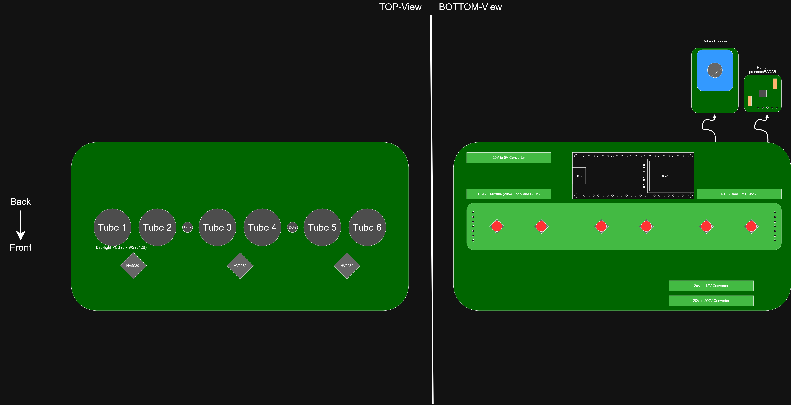
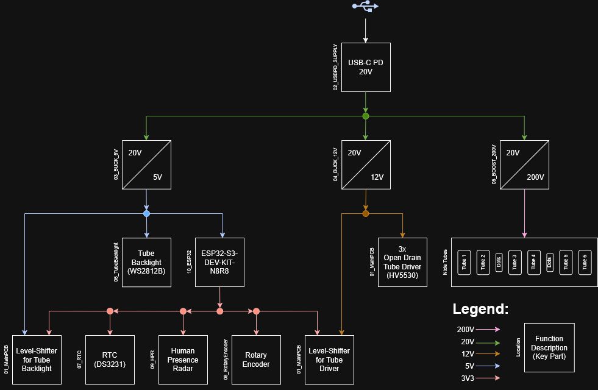
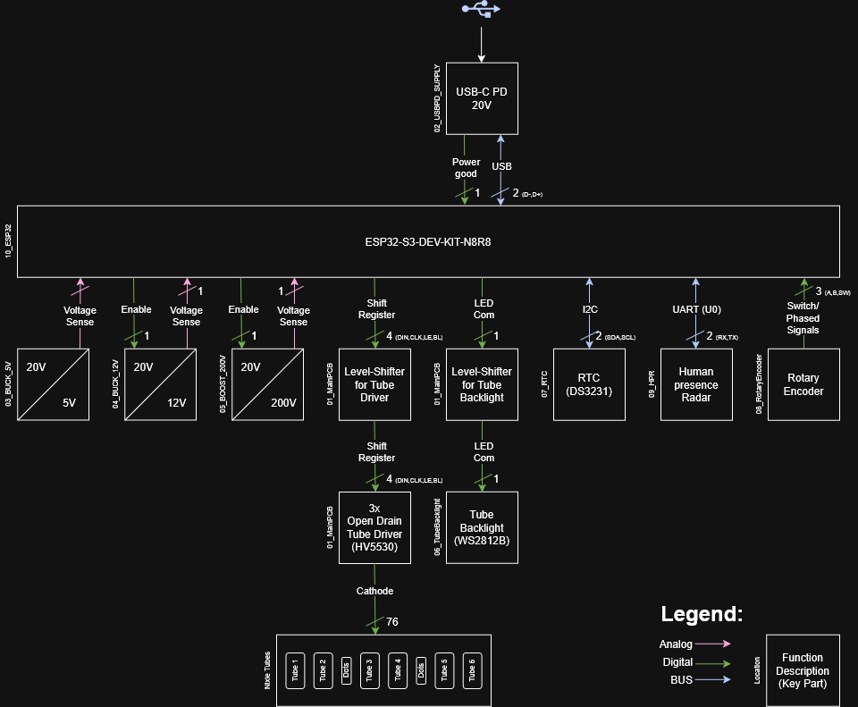

# Architecture

## Overview

  

## Power Tree

  

## Signal Flow

  

## Modules
  ### 01_MainPCB
  - **Purpose:** Tubes and driver, connection of all submodules
  - **Key part:** IN-14 / HV5530
  - **Interfaces:** in 20 V / out 200 V / enable / GND
  - **Key specs:** 
  - **Features:** LED ind. Human Presence, 
  - **Satisfies:** FR-01, NFR-02
  ### 02_USBPD_Supply
  - **Purpose:** 20V power supply and programming interface
  - **Key part:** STUSB4500
  - **Interfaces:** in USB PD / out 20V / I2C / USB / GND
  - **Key specs:** output current
  - **Features:** LED enable, LED Power Ok
  - **Satisfies:** NFR-01
  ### 03_Buck_5V
  - **Purpose:** Buck converter for 5V power supply of the ESP32-S3
  - **Key part:** TPS5430
  - **Interfaces:** in 20V / out 5V / GND
  - **Key specs:** output current, ripple, efficiency
  - **Features:** LED enable, LED Power Ok , same Design as 04_Buck_12V
  - **Satisfies:** -
  ### 04_Buck_12V
  - **Purpose:** Buck converter for 12V logic of tube drivers
  - **Key part:** TPS5430 / out 5V / enable
  - **Interfaces:** in 20V / out 12V / enable / GND
  - **Key specs:** output current , ripple, efficiency
  - **Features:** LED enable, LED Power Ok, same Design as 03_Buck_5V
  - **Satisfies:** -
  ### 05_Boost_200V
  - **Purpose:** 20 V -> 200 V for the tubes
  - **Key part:** LT3757
  - **Interfaces:** in 20 V / out 200 V / enable / GND
  - **Key specs:** output current, ripple, efficiency
  - **Features:** LED enable 
  - **Satisfies:** -
  ### 06_TubeBacklight
  - **Purpose:** Backlight of the IN-14 Tubes
  - **Key part:** WS2812B
  - **Interfaces:** in 5V / LED Bus / GND
  - **Key specs:** brightness
  - **Features:** -
  - **Satisfies:** FR-06
  ### 07_RTC
  - **Purpose:** Real Time clock 
  - **Key part:** DS3231 
  - **Interfaces:** in 3V3 / I2C / GND
  - **Key specs:** time accuracy
  - **Features:** LED power
  - **Satisfies:** FR-03
  ### 08_RotaryEncoder
  - **Purpose:** Manual time settings
  - **Key part:** EC11 / 74LVC1G14
  - **Interfaces:** in 3V3 / A / B / SW / GND
  - **Key specs:** maximum rotating frequency
  - **Features:** LED power / LED A / LED B / LED SW
  - **Satisfies:** FR-04
  ### 09_HPR (Human Presence Radar)
  - **Purpose:** Human presence detection
  - **Key part:** Waveshare  GMMD-mmWave-Sensor
  - **Interfaces:** in 3V3 / UART / GND
  - **Key specs:** detection range, detection reliability
  - **Features:** -
  - **Satisfies:** FR-05
### 10_ESP32
  - **Purpose:** Microcontroller unit
  - **Key part:** Waveshare ESP32-S3-DEV-KIT-N8R8
  - **Interfaces:** in 5V / GPIO / UART / I2C / USB / WiFi / GND
  - **Key specs:** -
  - **Features:** RGB LED
  - **Satisfies:** FR-02